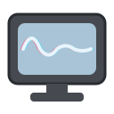
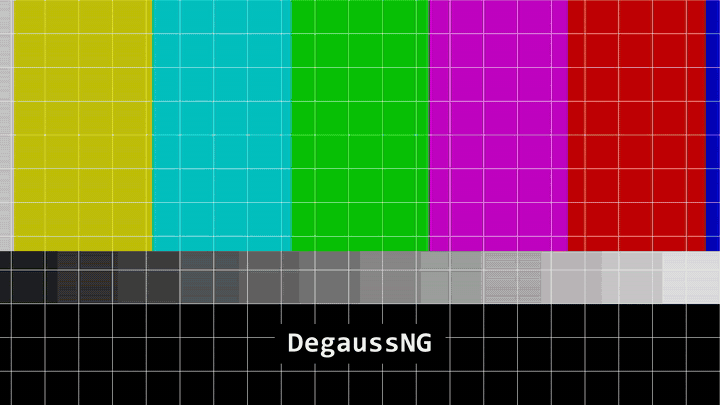
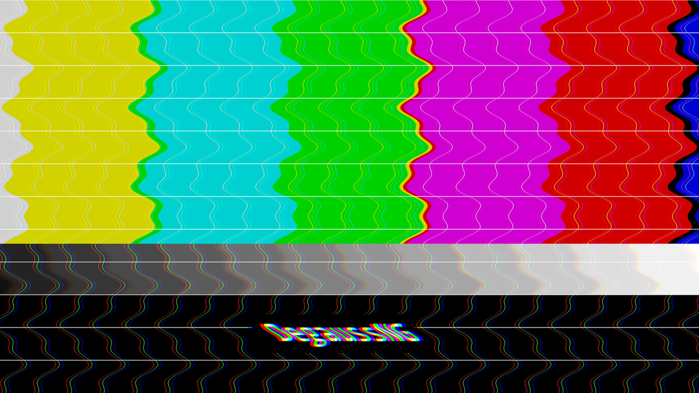
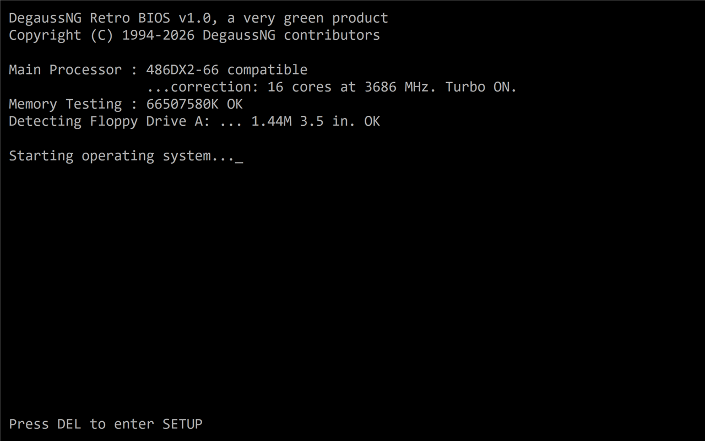

<p align="center">
  
</p>

<h1 align="center">DegaussNG</h1>

<p align="center"><b>Your flat screen, now with 1998 included.</b></p>

<p align="center">
  <a href="https://github.com/MKRWW/DegaussNG/actions/workflows/ci.yml"></a>
  <a href="https://github.com/MKRWW/DegaussNG/releases"></a>
  <a href="LICENSE"></a>
  <a href="#quick-start"></a>
  <a href="#build-from-source"></a>
</p>

<p align="center">
  <a href="https://github.com/MKRWW/DegaussNG/releases/latest">Download</a> · <a href="#features">Features</a> · <a href="#quick-start">Quick start</a> · <a href="#faq">FAQ</a>
</p>

<p align="center">
  
</p>

<p align="center"><em>One run of the effect over a test pattern: the geometry warbles and the colours fall apart, then everything settles.</em></p>

If you grew up in front of a tube monitor, you remember the sound: the low hum, the *bwoommm* of a
degauss coil, the picture wobbling as the colours fall apart. And the screech of a modem handshake,
and the BIOS counting its memory line by line before anything started. DegaussNG brings those back on
hardware that has none of them, because nothing here is a recording: the app draws and renders all of
it itself.

## Features

<table>
  <tr>
    <th>Degauss</th>
    <th>Dial-up</th>
    <th>Boot screen</th>
  </tr>
  <tr>
    <td>
      A hotkey pulls a live picture of every monitor through a CRT degauss. The geometry warbles, the
      colours fall apart and a low thump runs through the speakers. The default hotkey is
      <code>Ctrl+Alt+D</code>, and reduced motion keeps the same effect at about a third of its strength.
    </td>
    <td>
      When a real network connection comes back, the dial-up handshake plays again.
      <code>Short</code> is the compressed version, <code>Full</code> takes the whole time and adds the
      ringback and the long training. A click on the tray icon stops it.
    </td>
    <td>
      At sign-in the machine pretends to be an old 486 again. The memory counter only ever runs
      forward and the footer says <code>Press DEL to enter SETUP</code>. Any key or any click ends it.
    </td>
  </tr>
</table>

<table>
  <tr>
    <td align="center">
      <br>
      The effect at its peak: geometry warbled, colours split into fringes.
    </td>
    <td align="center">
      <br>
      The boot screen, counting its memory.
    </td>
  </tr>
</table>

Every sound and every picture is synthesized by the app itself, without samples or recordings.

## Quick start

1. Download the ZIP from [the latest release](https://github.com/MKRWW/DegaussNG/releases/latest).
2. Unpack it and run `DegaussNG.exe`.
3. Press `Ctrl+Alt+D`.

Nothing is installed and no .NET is needed: the exe carries the runtime with it. Windows 10 or 11,
64 bit. The app lives in the tray, and the exe is not signed, so SmartScreen may warn you the first
time: choose `More info`, then `Run anyway`.

## Using it

The tray menu, in order:

| Menu item | What it does |
| --- | --- |
| Degauss now | Runs the effect on every monitor right away. |
| Modem test | Plays the modem sound in the selected mode, even when the modem sound is off. |
| Boot screen now | Shows the fake boot screen once, even when it is off at startup. |
| Degauss enabled | Switches the hotkey on or off; `Degauss now` still works when it is off. |
| Reduced motion | Makes the effect and the boot screen calmer. |
| Modem sound | Switches the dial-up sound on a new connection on or off. |
| Modem mode | Chooses between `Short` and `Full`. |
| Boot screen at startup | Switches the boot screen at sign-in on or off. |
| Start with Windows | Adds or removes the sign-in entry. |
| Volume | Chooses 10 %, 30 %, 50 %, 70 % or 100 %. |
| Change hotkey... | Sets the hotkey, `Ctrl+Alt+D` by default. |
| Exit | Closes the overlays and quits the app. |

Three things worth knowing:

- `Ctrl+Alt+D` runs the effect, as long as `Degauss enabled` is on; `Change hotkey...` sets it.
- A click on the tray icon stops the modem sound.
- Any key or any click ends the boot screen.

## When does the modem sound play?

The sound is not played on every network change:

- The network has to be gone for at least 8 seconds first.
- It then has to stay up for 4 seconds before the handshake plays.
- At most once a minute, and never at app start.
- Virtual adapters such as WSL, Hyper-V, Docker and VPNs do not count.
- A reconnect after the machine slept counts as a real connection.

## Settings and files

<details>
<summary>Where DegaussNG keeps its settings</summary>

The settings live in `%APPDATA%\DegaussNG\config.json`:

| Field | Default |
| --- | --- |
| `DegaussEnabled` | `true` |
| `ReducedMotion` | `false` |
| `Volume` | `0.3` |
| `Hotkey` | `Ctrl+Alt+D` |
| `ModemEnabled` | `true` |
| `ModemMode` | `Short` |
| `BootEnabled` | `true` |

A corrupt file is moved to `config.json.bak` and the defaults are used. Problems are written to
`%LOCALAPPDATA%\DegaussNG\degauss.log`.

`Start with Windows` writes the value `DegaussNG` under
`HKCU\Software\Microsoft\Windows\CurrentVersion\Run`, and only when the item is switched on.

</details>

## Command line

<details>
<summary>Options for scripts and testing</summary>

| Option | What it does |
| --- | --- |
| `--autostart` | The argument the sign-in entry uses, and the boot screen plays once. |
| `--boot <log>` | Runs the boot screen once without tray, hotkey or settings, and writes the report line to `<log>`. |
| `--netstate <log>` | Writes whether the machine is connected, and one line per network adapter, to `<log>`. |
| `--selftest <cycles> <log>` | Runs `<cycles>` degauss cycles without tray, hotkey, sound or settings, and writes the counts to `<log>`. |

</details>

## FAQ

**Does this really degauss my monitor?**

No. A flat panel has no shadow mask that could pick up a magnetic field, so there is nothing to degauss. The effect is a picture and a sound.

**Can it harm my screen?**

No. It only draws a short animation on top of the desktop.

**Why is the download so big?**

It bundles the .NET runtime, so nothing has to be installed.

**Windows warns me about the file.**

The exe is not signed, so SmartScreen asks first. Choose `More info`, then `Run anyway`. The source is all here.

**How do I make it quieter or silent?**

The `Volume` menu, `Modem sound` and `Boot screen at startup`.

**How do I uninstall it?**

Exit it, switch off `Start with Windows` first if it was on, then delete the exe and the folders
`%APPDATA%\DegaussNG` and `%LOCALAPPDATA%\DegaussNG`.

## Under the hood

- The overlay is a WPF pixel shader, compiled at run time from the HLSL source, drawn over a
  screenshot of each monitor.
- Playback runs through NAudio.
- Every sound is rendered sample by sample by `tools/SoundSynth` and is byte-for-byte reproducible.
- The debounce, adapter and boot logic is covered by unit tests.

## Build from source

You need the .NET 8 SDK.

```
dotnet build -c Release
dotnet test -c Release
```

The sounds are generated, not stored as recordings. To regenerate them byte for byte:

```
dotnet run --project tools/SoundSynth -- assets/sounds
```

## Privacy

No network requests and no telemetry. The app only reads the state of the local network adapters.

## License

[MIT](LICENSE). All sounds and graphics are original; no trademarks or third-party samples are used.
